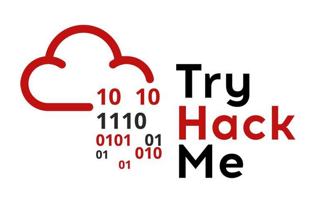

# Umar3P Challenges TryHackMe

Welcome to my writeups for [TryHackMe](https://tryhackme.com/) [challenges](https://tryhackme.com/challenges)

These writeups are mainly a documentation for myself but I hope others will benefit from them as well.  

You will find many challenges here.

## Challenges

- [Medium Challenges](Challenges/Medium/README.md)
  - [Active Directory](Challenges/Medium/README.md#active-directory)
  - [Digital Forensics and Incident Response](Challenges/Medium/README.md#digital-forensics-and-incident-response)
  - [Exploitation](Challenges/Medium/README.md#exploitation)
  - [Full Pwn](Challenges/Medium/README.md#full-pwn)
  - [Miscellaneous](Challenges/Medium/README.md#miscellaneous)

- [Easy Challenges](Challenges/Easy/README.md)
  - [Cryptography](Challenges/Easy/README.md#cryptography)
  - [Digital Forensics and Incident Response](Challenges/Easy/README.md#digital-forensics-and-incident-response)
  - [Full Pwn](Challenges/Easy/README.md#full-pwn)
  - [Jeopardy Style CTFs](Challenges/Easy/README.md#jeopardy-style-ctfs)
  - [Miscellaneous](Challenges/Easy/README.md#miscellaneous)
  - [Reverse Engineering](Challenges/Easy/README.md#reverse-engineering)

- [Info Challenges](Challenges/Info/README.md)
  - [Exploitation](Challenges/Info/README.md#exploitation)

## Learning Paths

- [Medium Learning Paths](Learning_Paths/Medium/README.md)
  - [Jr Penetration Tester](Learning_Paths/Medium/Jr_Penetration_Tester.md)

- [Easy Learning Paths](Learning_Paths/Easy/README.md)
  - [Cyber Security 101](Learning_Paths/Easy/Cyber_Security_101.md)
  - [Pre Security](Learning_Paths/Easy/Pre_Security.md)
  - [SOC Level 1 (Legacy)](Learning_Paths/Easy/SOC_Level_1_Legacy.md)
  - [Web Fundamentals](Learning_Paths/Easy/Web_Fundamentals.md)

## Modules

- [Medium Modules](Modules/Medium/README.md)
  - [Artificial Intelligence](Modules/Medium/README.md#artificial-intelligence)
  - [Digital Forensics and Incident Response](Modules/Medium/README.md#digital-forensics-and-incident-response)
  - [Exploitation](Modules/Medium/README.md#exploitation)
  - [Networking](Modules/Medium/README.md#networking)

- [Easy Modules](Modules/Easy/README.md)
  - [Active Directory](Modules/Easy/README.md#active-directory)
  - [Cryptography](Modules/Easy/README.md#cryptography)
  - [Defensive Security](Modules/Easy/README.md#defensive-security)
  - [Exploitation](Modules/Easy/README.md#exploitation)
  - [Fundamentals](Modules/Easy/README.md#fundamentals)
  - [Networking](Modules/Easy/README.md#networking)
  - [Offensive Security](Modules/Easy/README.md#offensive-security)
  - [Penetration Testing](Modules/Easy/README.md#penetration-testing)
  - [Scripting and Programming](Modules/Easy/README.md#scripting-and-programming)
  - [Web](Modules/Easy/README.md#web)

- [Info Modules](Modules/Info/README.md)
  - [Fundamentals](Modules/Info/README.md#fundamentals)
  - [Windows](Modules/Info/README.md#windows)

## Networks

- [Medium Networks](Networks/Medium/README.md)
  - [Active Directory](Networks/Medium/README.md#active-directory)

- [Easy Networks](Networks/Easy/README.md)
  - [Active Directory](Networks/Easy/README.md#active-directory)
  - [Lateral Movement](Networks/Easy/README.md#lateral-movement)

## Walkthroughs

- [Medium Walkthroughs](Walkthroughs/Medium/README.md)
  - [Artificial Intelligence](Walkthroughs/Medium/README.md#artificial-intelligence)
  - [Cyber Threat Intelligence](Walkthroughs/Medium/README.md#cyber-threat-intelligence)
  - [Defensive Security](Walkthroughs/Medium/README.md#defensive-security)
  - [Exploitation](Walkthroughs/Medium/README.md#exploitation)
  - [Networking](Walkthroughs/Medium/README.md#networking)
  - [Reverse Engineering](Walkthroughs/Medium/README.md#reverse-engineering)
  - [Scripting and Programming](Walkthroughs/Medium/README.md#scripting-and-programming)
  - [Web](Walkthroughs/Medium/README.md#web)
  - [Windows](Walkthroughs/Medium/README.md#windows)

- [Easy Walkthroughs](Walkthroughs/Easy/README.md)
  - [Active Directory](Walkthroughs/Easy/README.md#active-directory)
  - [Artificial Intelligence](Walkthroughs/Easy/README.md#artificial-intelligence)
  - [Containerization and Virtualization](Walkthroughs/Easy/README.md#containerization-and-virtualization)
  - [Cryptography](Walkthroughs/Easy/README.md#cryptography)
  - [Cyber Threat Intelligence](Walkthroughs/Easy/README.md#cyber-threat-intelligence)
  - [Defensive Security](Walkthroughs/Easy/README.md#defensive-security)
  - [Digital Forensics and Incident Response](Walkthroughs/Easy/README.md#digital-forensics-and-incident-response)
  - [Enumeration](Walkthroughs/Easy/README.md#enumeration)
  - [Exploitation](Walkthroughs/Easy/README.md#exploitation)
  - [Fundamentals](Walkthroughs/Easy/README.md#fundamentals)
  - [Linux](Walkthroughs/Easy/README.md#linux)
  - [Malware Analysis](Walkthroughs/Easy/README.md#malware-analysis)
  - [Networking](Walkthroughs/Easy/README.md#networking)
  - [Offensive Security](Walkthroughs/Easy/README.md#offensive-security)
  - [Reverse Engineering](Walkthroughs/Easy/README.md#reverse-engineering)
  - [Scripting and Programming](Walkthroughs/Easy/README.md#scripting-and-programming)
  - [Web](Walkthroughs/Easy/README.md#web)
  - [Windows](Walkthroughs/Easy/README.md#windows)

- [Info Walkthroughs](Walkthroughs/Info/README.md)
  - [Exploitation](Walkthroughs/Info/README.md#exploitation)
  - [Linux](Walkthroughs/Info/README.md#linux)
  - [Miscellaneous](Walkthroughs/Info/README.md#miscellaneous)
  - [Networking](Walkthroughs/Info/README.md#networking)
  - [Web](Walkthroughs/Info/README.md#web)
  - [Windows](Walkthroughs/Info/README.md#windows)
- RosanaFSS ([Medium](https://medium.com/@RosanaFS) and [GitHub](https://github.com/RosanaFSS/TryHackMe_Cybersecurity_Journey))
- [Z3pH7](https://medium.com/@Z3pH7)
